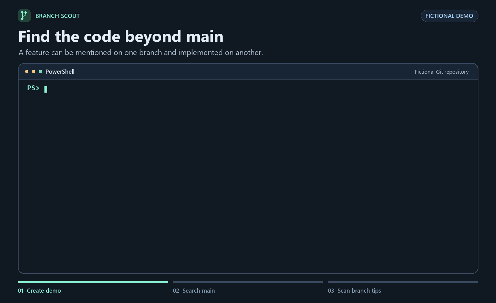

# Branch Scout

Branch Scout is a read-only CLI for searching across Git branches without switching your checkout. Search for a keyword or code identifier to find documentation mentions and code matches, each with its branch ref, commit hash, file path, and line number.



## Try it in 30 seconds

With **Node.js 22+** and **Git 2.45+** on `PATH`, clone the project and open its directory.

```text
git clone https://github.com/withoutsultang/branch-scout.git
cd branch-scout
```

The scanner uses Node.js and Git with zero package dependencies. The `--fictional` demo uses an invented trail planner and waypoint alert. It creates a fresh temporary repository with spaces and Korean characters in its path and leaves it on `main`.

**Windows PowerShell**

```powershell
$demo = node ./scripts/create-demo.mjs --fictional
git --no-lazy-fetch -C "$demo" grep -n -F -e waypointAlert main --
node ./bin/branch-scout.mjs --repo "$demo" --query waypointAlert --base main
```

**macOS or Linux (Bash or Zsh)**

```bash
demo="$(node ./scripts/create-demo.mjs --fictional)"
git --no-lazy-fetch -C "$demo" grep -n -F -e waypointAlert main --
node ./bin/branch-scout.mjs --repo "$demo" --query waypointAlert --base main
```

The first search shows one hit at `main:README.md:3`. Branch Scout also finds a code match at `feature/waypoint-alerts:src/alerts.mjs:1`. The documentation section groups hits at the same path and line and lists each branch and commit underneath. The sample function delegates to an injected notifier. Code hits identify implementation candidates, and deployment requires separate evidence.

<details>
<summary>View the terminal output</summary>

```text
Comparison | "refs/heads/main" has documentation matches only. Code matches on 1 other branch.
Search complete | local and stored remote-tracking branch tips | 2 branches | 2/2 commits searched
Checkout  branch "refs/heads/main" @ 39650fbf8f76950b355f6e339a42b0aad90f7e88
Baseline  "refs/heads/main" @ 39650fbf8f76950b355f6e339a42b0aad90f7e88 (explicit)

Code candidates
  "src/alerts.mjs":1  "refs/heads/feature/waypoint-alerts" @ 457bd227a4027307a3864204296ab50b92c159f4

Documentation matches
  "README.md":3
    "refs/heads/feature/waypoint-alerts" @ 457bd227a4027307a3864204296ab50b92c159f4
    "refs/heads/main" @ 39650fbf8f76950b355f6e339a42b0aad90f7e88
```

</details>

Verify the sample's code location directly with Git.

```text
git --no-lazy-fetch -C "$demo" grep -n -F -e waypointAlert 457bd227a4027307a3864204296ab50b92c159f4 -- src/alerts.mjs
```

## Use the skill in an agent

With your agent installed and signed in, run one installer command from the Branch Scout folder. Both shells above set `$demo`. For another project, substitute its path for `"$demo"`.

| Agent | Install the project skill | Start in the target directory | Invoke |
| --- | --- | --- | --- |
| [Codex](https://learn.chatgpt.com/docs/build-skills) | `node ./scripts/install-skill.mjs codex "$demo"` | `codex` or open the folder in Codex | Select `$branch-scout` and submit the question below. |
| [Claude Code](https://code.claude.com/docs/en/skills#choose-where-skills-load) | `node ./scripts/install-skill.mjs claude "$demo"` | `claude` | Prefix the question with `/branch-scout`. |
| [Gemini CLI](https://geminicli.com/docs/cli/skills/#discovery-tiers) | `node ./scripts/install-skill.mjs gemini "$demo"` | `gemini` | Ask it to use the `branch-scout` skill, then submit the question. Use `/skills list` to check discovery and approve activation if prompted. |

Open the demo directory with `Set-Location -LiteralPath $demo` in PowerShell or `cd "$demo"` in Bash or Zsh. Use this question and the invocation for your agent.

> Where is waypointAlert mentioned or implemented in this repository? Use main as the baseline. Cite each exact branch ref, commit hash, file and line. Separate documentation mentions from code candidates. Keep the repository read-only.

Codex and Gemini CLI share `.agents/skills/branch-scout`. Claude Code uses `.claude/skills/branch-scout`. The installer copies the [complete skill](.agents/skills/branch-scout), including the scanner. It preserves existing copies with local edits. To update a different copy, move it aside and rerun the installer. The agent session needs permission to read the target and run Node.js and Git.

## Search across Git branches by keyword

```text
node ./bin/branch-scout.mjs --repo "../my project" --query waypointAlert --base main --json
```

- `--query` accepts one literal substring on a single line. Use `--query=<value>` when it begins with a dash. Matching is case-sensitive.
- `--base` selects the comparison branch independently of the checkout. Use a full ref such as `refs/heads/main` when a short name is ambiguous. The default uses the stored `origin/HEAD` target or the only local branch named `main` or `master`. Otherwise the baseline is unresolved.
- Plain text highlights a documentation-only baseline when code matches on another branch. JSON keeps individual match records and includes `status`, `scope`, `checkout`, `baseline`, `branches`, `matches`, and `issues`. Each match contains `ref`, `branch`, `commit`, `source`, `file`, `line`, and `kind`. Both formats report locations and omit matched lines, config values, and remote URLs.

| Exit code | Meaning |
| --- | --- |
| `0` | Completed within scope, including zero matches. An unresolved baseline is reported separately. |
| `1` | The scan was partial or could not start. Check `issues` and the searched commit count. |
| `2` | Invalid arguments. Usage is printed to stderr. |

## Which Git branches does Branch Scout search?

By default, Branch Scout searches the latest committed snapshot of each local branch and each remote-tracking branch stored in your clone. Stored remote-tracking refs may be stale. The scanner reads each unique commit once and attributes hits to every direct ref that points to it.

It disables lazy fetching and reports missing objects as incomplete coverage. Worktree edits, the index, history, tags, submodules, and binary files are outside the scan. Classification uses filenames and extensions. A commit exceeding the 16 MiB Git output buffer is reported as incomplete. See the [Git command documentation](https://git-scm.com/docs/git/2.45.0) and the [git grep manual](https://git-scm.com/docs/git-grep).

## Run the tests

```text
node --test
```

The tests create disposable repositories, verify locations with Git, check read-only behavior, and run the scanner from all three installed skill paths. The [GitHub Actions matrix](.github/workflows/test.yml) defines the same suite for Windows, macOS, and Linux. See the [v0.1.0 validation notes (Korean)](VALIDATION.md) for the earlier agent-session results and steps to reproduce them.

## License

Branch Scout is available under the [MIT License](LICENSE).
